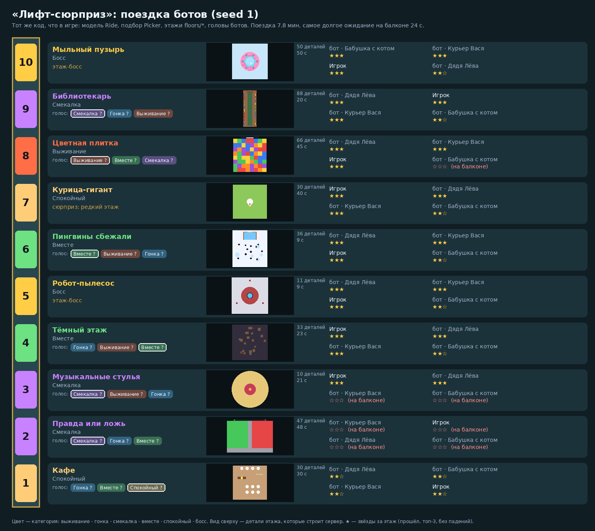

# Лифт-сюрприз (Surprise Lift)

Вечеринка из мини-ситуаций для Roblox: все игроки сервера (1–12) едут **в одном лифте**. На каждой остановке двери открываются на этаж с ситуацией на 30–60 с — лава, тающая плитка, боулинг, «правда или ложь», библиотекарша, музыкальные стулья, тёмный этаж с рубильниками, торт на доставку, сбежавшие пингвины… Пережил или выполнил — звёзды и монеты, все снова в кабине, едем выше. Поездка — 10 этажей (~8 мин), 5-й и 10-й — **боссы** (робот-пылесос, гигантский мыльный пузырь), после 10-го — крыша с итогами, и лифт смешно падает в лобби. Где-то есть секретный **Подвал (13)**. Насилия нет: «выбыл» — значит смешно улетел на **мягкий балкон зрителей**, откуда смотришь, жмёшь реакции и возвращаешься в кабину после этажа.

Дизайн-документ: [`docs/DESIGN.md`](docs/DESIGN.md) · Плейтест в Studio: [`docs/PLAYTEST.md`](docs/PLAYTEST.md) · Публикация и монетизация: [`docs/PUBLISH.md`](docs/PUBLISH.md) · Новый этаж за сессию: [`docs/NEW_FLOOR.md`](docs/NEW_FLOOR.md) · Локальная сессия Claude + Studio MCP: [`docs/LOCAL_SESSION.md`](docs/LOCAL_SESSION.md) · Уроки: [`docs/LESSONS.md`](docs/LESSONS.md)



*Поездка одного «игрока» (автопилот — голова бота среднего уровня) и трёх ботов-пассажиров — тот же код, что в игре. Снизу вверх 10 остановок: цвет — категория этажа, «голос» — какие категории были на кнопках (выбранная обведена), «сюрприз» — лифт решил сам. В середине — вид сверху на этаж из тех же деталей-примитивов, которые строит сервер. Справа — звёзды за этаж; «на балконе» — выбыл. Здесь на 2-м этаже вся четвёрка ошиблась в «Правде или лжи», а на 7-м выпал редкий «Курица-гигант».*

Всё построено кодом из примитивов: кабина, балкон, 19 этажей, боты-пассажиры, шапки и аксессуары, эффекты. Сторонних моделей, звуков и ассетов нет; мелодия лифта и звонки — синтез из встроенного «пинга».

---

## Как запустить в Roblox Studio (Windows)

### Один раз
Rokit и плагин Rojo уже стоят после прошлых игр. Если нет — см. README репозитория `roblox`.
```powershell
cd "D:\programming\projects\2.IntelliJ_IDEA\Java"
git clone https://github.com/covest2051/roblox-lift.git
cd roblox-lift
git checkout claude/roblox-surprise-lift-9t5eml
rokit install
```

### Поиграть
```powershell
git pull
rojo build -o game.rbxl
```
Открой `game.rbxl` в Studio, включи **View → Output**, нажми **Play** (F5). Ты в лобби у дверей лифта; через 20 с все садятся в кабину, с тобой — три бота-пассажира. Голосуй за этаж кнопками справа снизу (или 1–3).

### Живая синхронизация кода
Открой `game.rbxl`, запусти `rojo serve` (окно не закрывать), в Studio: **Plugins → Rojo → Connect**.

### Вдвоём и больше в Studio
**Test → Clients and Servers** → 2–4 игрока → **Start**. Людей меньше 4 — ботов столько, чтобы было 4.

## Управление
| ПК | Телефон | Что делает |
|---|---|---|
| WASD, пробел | стик слева, прыжок | ходить и прыгать на этаже |
| **1 / 2 / 3** | три большие кнопки справа снизу | голос за категорию этажа (в кабине) |
| **E** | большая кнопка действия | 🪑 Сесть · 👆 Нажать · 🎁 Подарок · 📸 Фото — когда этаж это предлагает |
| | реакции (на балконе) | 😂 👏 😱 🔥 ❤️ 🙈 (ещё 6 — «Эмоции+») |
| | 🏢 Коллекция · 🛍 Магазин | открыто N/19, рекорды; облик, капсула, пропуска |
| | DBG (только Studio) | этаж по выбору, следующая фаза, босс, Подвал, автопилот, скорость, боты, монеты, самотест, RU/EN |

---

## Для разработки

### Структура
```
src/shared/      логика без инстансов: тестируется в Lune
  Config         все числа: время фаз, подбор, боты, награды, ID товаров
  Ride           модель поездки: фазы, участники, голоса (VIP ×2), подбор, этаж, балкон,
                 боты-пассажиры, звёзды и монеты, «Подвал сейчас!», окно оплаты, отладка
  Picker         подбор этажа: боссы на 5 и 10, без повторов, категории, спокойный, сюрпризы
  Floors         реестр этажей и «движок» этажа (шаг, анти-чит позиций, шаг бота, итоги, звёзды)
  floors/*       19 этажей + лобби и крыша: build (детали из примитивов), step, input, bot, …
  FloorKit       общие кирпичики этажа: детали и опоры, выбывание, чекпоинты, приёмы ботов
  Body, Bots     кинематика тела бота/тестов (прыжок, батут, лёд, гравитация, зеркало) и уровни
  Catalog, Profile, Rewards, Questions, Strings
src/server/      LiftService (адаптер над Ride: позиции, события → мир и клиентам), World (кабина,
                 балкон, сцена из деталей, боты), данные, покупки, облик, запросы (Actions), SelfTest
src/client/      Hud (табло, голосование, действие, реакции, итоги), Collection, Shop, Controls
                 (зеркало, батуты, темнота, тряска), StageView (надписи на языке игрока), Fx, DebugPanel
tests/           *.spec.luau — подбор, поездка, этажи на ботах, ожидание, анти-чит, каталог, тексты
tests/engine/    прогон собранного place на «заглушке» движка (сервер и клиент)
scripts/         проверка place и API, картинка поездки, check.sh
```

### Проверки
```bash
./scripts/check.sh            # всё сразу: формат, линтер, тесты, сборка, прогоны на заглушке
```
С проверкой API (дамп с GitHub):
```bash
curl -sSfLo API-Dump.json https://raw.githubusercontent.com/MaximumADHD/Roblox-Client-Tracker/roblox/API-Dump.json
API_DUMP=API-Dump.json ./scripts/check.sh
```
Что проверяется (числа — из вывода `lune run tests/run.luau`, сиды фиксированы):
- `tests/floors.spec` — **каждый из 19 этажей на ботах** (та же голова, что у ботов-пассажиров): строится из примитивов, работает при 1 и 12 игроках, длится не дольше лимита (30–60 с), **никто не выбывает в первые 3 с**, и **«ничего не делает» < «наугад» < «новичок» < «средний»** (среднее «звёзды + доля очков», 40 смешанных забегов):

  | Этаж | ничего | наугад | новичок | средний | 4 средних проходят |
  |---|---|---|---|---|---|
  | 🔥 Пол — лава | 0.15 | 0.57 | 1.19 | 2.69 | 68% |
  | 🔥 Тающая плитка | 0.08 | 0.12 | 2.28 | 3.20 | 60% |
  | 🔥 Боулинг | 0.14 | 0.15 | 1.61 | 2.65 | 60% |
  | 🔥 Цветная плитка | 0.13 | 0.19 | 0.85 | 2.55 | 69% |
  | 🔥 Гравитация пляшет | 0.00 | 0.61 | 1.12 | 1.82 | 66% |
  | 🏁 Зеркальный этаж | 0.00 | 0.01 | 1.85 | 2.65 | |
  | 🏁 Пузыри | 0.00 | 0.01 | 2.75 | 3.40 | |
  | 🏁 Каток | 0.00 | 1.87 | 3.07 | 3.40 | |
  | 🧠 Правда или ложь | 0.06 | 0.20 | 0.48 | 1.96 | |
  | 🧠 Библиотекарь | 0.00 | 1.22 | 2.71 | 3.50 | |
  | 🧠 Музыкальные стулья | 0.00 | 0.78 | 2.46 | 3.50 | |
  | 🤝 Тёмный этаж | 2.45 | 2.66 | 2.99 | 3.07 | |
  | 🤝 Торт на доставку | 1.85 | 3.04 | 3.12 | 3.27 | |
  | 🤝 Пингвины сбежали | 2.90 | 3.01 | 3.43 | 3.47 | |
  | 😌 Курица-гигант | 2.00 | 3.27 | 3.33 | 3.49 | |
  | 😌 Кафе (без мест) | 2.00 | 2.00 | 2.50 | 2.50 | |
  | 👑 Робот-пылесос | 0.11 | 0.43 | 0.50 | 2.63 | |
  | 👑 Мыльный пузырь | 2.18 | 2.44 | 3.26 | 3.29 | |
  | ❓ Подвал | 2.40 | 3.07 | 3.26 | 3.49 | |

  На совместных этажах «ничего не делает» получает звезду, если команда справилась, но всегда ниже остальных (нет топ-3 по вкладу). Бездействие выгодно только в Кафе (там все равны).
- `tests/picker.spec` — **10 000 поездок** со случайными голосами: без повторов, категория не больше 2 раз подряд, спокойный не чаще раза в 4 этажа, боссы на 5 и 10 (разные), каждый обычный этаж встречается; сюрпризы на обычной остановке: Гравитация 3.85%, Курица 3.23%, Подвал 1.83%; спокойных — 13.0% остановок; ничья и «никто не голосовал» — случайно; VIP ×2.
- `tests/wait.spec` — **поездка целиком на ботах** (24 поездки, 1–4 человека-автопилота): длина 7.3–9.8 мин (медиана 8.3), **самое долгое ожидание на балконе 58 с** (лимит теста 64 с; медиана по поездкам 43 с); вошедший посреди этажа ждёт не дольше одного этажа.
- `tests/ride.spec` — фазы, боты добирают экипаж до 4 и уходят, когда приходят люди, голос только в кабине и только людей, вход посреди этажа → балкон → кабина, выход посреди этажа, все ушли → лифт стоит без ботов, «Подвал сейчас!» (раз за поездку, ждёт обычную остановку после босса), окно оплаты продлевает кабину один раз, отладка.
- `tests/anticheat.spec` — телепорт к кнопке гонки не засчитывается (позиция для правил ограничена скоростью), «нажать / сесть / подарок» только рядом и вовремя, ответ «правды/лжи» не уходит клиенту до раскрытия.
- `tests/catalog.spec`, `tests/strings.spec` — шансы капсулы ровно 100% (60/28/10/2) и бросок по ним, покупки, VIP, коллекция и рекорды, ежедневный подарок, миграция профиля; RU/EN, каждый ключ из кода существует, 40 утверждений без повторов.
- `tests/engine/server_sim` (82 проверки) — мир из примитивов, лобби, **полная поездка из 10 этажей** с автопилотом и ботами-пассажирами, голос кнопкой, анти-чит, награды/коллекция/leaderstats, крыша и падение, вход и выход посреди этажа, «Подвал сейчас!» с объявлением, отладка атрибутом `DebugCommand`, магазин, капсула и PolicyService, чеки, сбой DataStore, пустой сервер, самотест.
- `tests/engine/client_sim` (86 проверок) — HUD, голос кнопками, тёмный этаж (свет гаснет, фонарик, «НАЖАТЬ»: издалека — «Подойди ближе», рядом — рубильник), итог этажа, лава → балкон → реакции, поездка до крыши, коллекция, магазин, язык, **раскладка 667×375, 812×375, 1280×720 и 1600×900 (масштаб 1.25)**: всё на экране, без наложений, левый низ свободен для стика, окна вписаны.

### Картинка поездки
```bash
lune run scripts/export_ride.luau "" build/ride.json    # без seed — первая поездка с сюрпризом и выбывшим
python3 scripts/render_ride.py build/ride.json docs/img/ride.png
```

### Где менять баланс
`src/shared/Config.luau` — время фаз (`Ride`), подбор (`Picker`), боты (`Bots`), награды, ID товаров. Числа этажа — в его модуле (`floors/<id>.luau`, таблица в начале). После правки — `lune run tests/run.luau floor` (этажи) или `./scripts/check.sh` целиком. Подбирать числа удобно локальным скриптом `tests/_tune.luau <id>` (файлы `tests/_*.luau` не в репозитории — см. `docs/NEW_FLOOR.md`).
